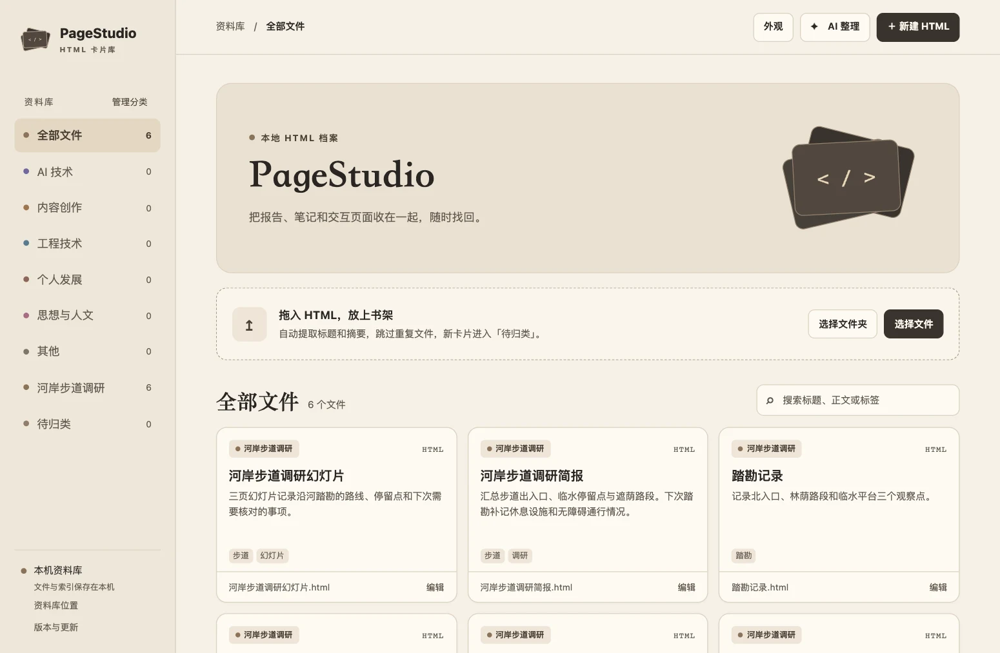
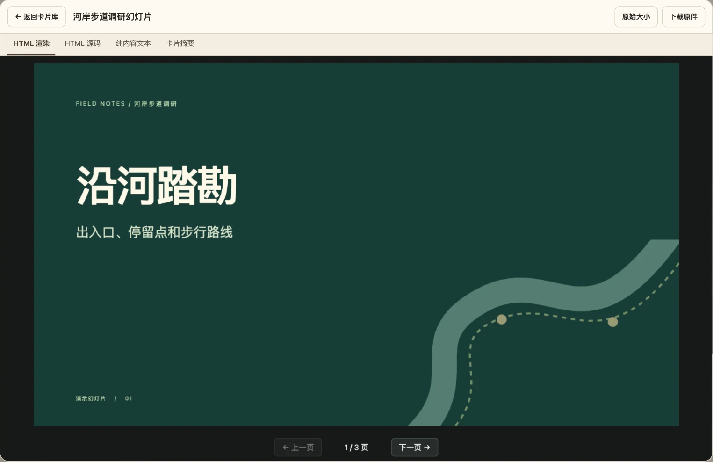
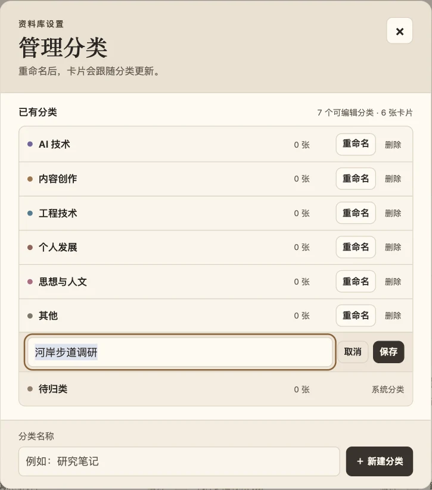

# PageStudio · DeepSeek Harness

PageStudio 是 DeepSeek Harness 的本地 HTML 卡片库。把生成的 HTML 导入后，可以在插件内阅读、编辑，也可以通过 DeepSeek Harness 的对话制作卡片、生成摘要和整理资料。

## 界面预览

截图来自 PageStudio v0.5.9 的演示资料库。

| 卡片阅读 | 分类管理 |
| --- | --- |
|  |  |

## 安装与更新

1. 如果已安装旧版 PageStudio，先在 DSH 插件页卸载旧版。
2. 打开「插件 → 添加插件 → 安装第三方插件」，输入 `https://github.com/Linguage/pagestudio`。
3. DSH 会安装最新发行版。启用后，从侧栏打开 PageStudio。

也可以[下载安装包](https://github.com/Linguage/pagestudio/releases/latest)，在同一界面填入本地路径。资料库独立保存在本机，重新安装后可以继续使用。

## 使用

- **导入。** 拖入 HTML 文件，新卡片会进入「待归类」。幻灯片由 JSON 清单组织逐页 HTML，可用 `/html-cards-normalize-deck` 整理后导入为一张卡片。
- **阅读和编辑。** 打开卡片可以看页面、读纯文本、改源码或编辑摘要。DSH 桌面版支持把页面导出成图片。
- **整理和查找。** 用「管理分类」新建、重命名或删除分类。可以给卡片加标签，再按标题、正文或标签搜索。
- **切换资料库。** 在侧栏底部打开「资料库位置」，选择已有资料库或新建一个。

## 用 AI 辅助整理

- **整理一张卡片。** 打开「卡片摘要」，点「AI 生成整理建议」，在 DeepSeek Harness 对话侧栏发送请求。建议会回到卡片上，可以直接采用，也可以填入编辑区修改后再保存。建议包括标题、分类、标签和摘要。
- **整理一批待归类卡片。** 在资料库点「AI 整理」，检查或修改对话草稿后发送。AI 可以从已有分类中选一项、补标签，并按需要改文件名。

## 按项目整理 · v0.6.0

在资料库导航切到「项目」，按任务归集卡片。打开项目后可以直接导入或新建 HTML；已有卡片可在「编辑」中勾选一个或多个所属项目。窄窗口的分类和项目目录从底部展开。

也可以在 DeepSeek Harness 里说「把河岸步道调研相关的卡片加入『河岸调研』项目」。`/html-cards-organize` 会查找相关卡片并加入指定项目，原有分类和标签随卡片保留。制作或导入卡片时也可指定项目。

## 内置 Skills

在 DSH 对话中输入命令，并说明要处理的内容或文件。

| 命令 | 用途 |
| --- | --- |
| `/html-cards-create` | 把当前对话、文章或 Markdown 做成 HTML 信息卡并存入资料库。 |
| `/html-cards-import` | 把已有 HTML 成果导入资料库。 |
| `/html-cards-normalize-deck` | 整理多页 HTML 的页序与版式，可按要求导入并逐页预览。 |
| `/html-cards-organize` | 给待归类卡片补分类、标签和文件名。v0.6.0 支持按任务归集到项目。 |

## 项目维护

开发预览、测试、扩展入口、旧文件导入与发版步骤见[维护与扩展指南](docs/maintenance.md)。

## 开源协议

PageStudio 采用 [MIT 许可证](LICENSE)。随项目分发的第三方组件按各自的协议授权。

## 致谢

感谢以下开源项目。PageStudio 的阅读器使用了这些组件。

| 组件 | 用途 | 许可 |
| --- | --- | --- |
|  [Tailwind CSS](https://github.com/tailwindlabs/tailwindcss/tree/v3.4.17) | 渲染使用 Tailwind CSS 的页面 | [MIT](vendor/tailwind.LICENSE) |
|  [JSON5](https://github.com/json5/json5/tree/v2.2.3) | 读取页面中的 Tailwind 配置 | [MIT](vendor/json5.LICENSE) |
|  [Font Awesome Free](https://github.com/FortAwesome/Font-Awesome/tree/6.4.0) | 提供预览所用的图标、字体和样式 | [CC BY 4.0、SIL OFL 1.1、MIT](vendor/fontawesome.LICENSE) |
|  [MathJax](https://github.com/mathjax/MathJax/tree/3.2.2) | 渲染数学公式 | [Apache 2.0](vendor/mathjax.LICENSE) |

组件版本和分发来源见[第三方来源清单](vendor/SOURCES.md)。
